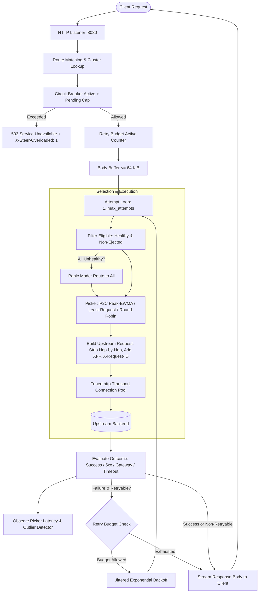

# steerlb: System Design & Architecture

`steerlb` is a lightweight, production-grade Layer 7 HTTP load balancer built from scratch in Go. It demonstrates advanced failure domain handling, retry storm mitigation, outlier ejection capping, peak-EWMA tail latency optimization, and zero-downtime hot reloading.

---

## 1. Request Path Architecture

---

## 2. Key Decisions & Rationale

### 2.1 Handcrafted Proxy Core vs. `httputil.ReverseProxy`
- **Decision**: Implemented the proxy directly on `net/http` with a tuned `http.Transport`.
- **Rationale**: `httputil.ReverseProxy` obscures retry loop boundaries, per-try context timeouts, retry budget consumption, and custom error mapping. By implementing the attempt loop directly:
  - Per-try timeouts (`PerTryTimeout`) cancel only the active upstream attempt context.
  - Request bodies are buffered up to 64 KiB so they can be re-read across attempts. Bodies exceeding 64 KiB are streamed unbuffered and never retried.
  - Hop-by-hop headers per RFC 9110 §7.6.1 and headers enumerated in `Connection` are stripped explicitly.

### 2.2 Load Balancing Algorithms
1. **Round-Robin**: Wait-free atomic counter (`atomic.AddUint64(&counter, 1)`).
2. **Power-of-Two-Choices (Least Request P2C)**: Samples two distinct random eligible endpoints and selects the one with fewer in-flight requests.
3. **Power-of-Two-Choices Peak-EWMA (`p2c_ewma`)**:
   - Calculates endpoint cost as:
     $$\text{cost} = \text{EWMA}_{\text{RTT}} \times (\text{inflight} + 1)$$
   - EWMA decays over time with time constant $\tau = 10\text{s}$ ($\alpha = \exp(-\Delta t / \tau)$).
   - Any observed sample greater than the current decayed value raises the EWMA immediately ("peak" behavior), quickly reacting to degraded backends.

### 2.3 Outlier Ejection & Safety Caps
- **Passive Detection**: Counts consecutive 5xx responses and gateway failures (connect failure, resets, timeouts).
- **Fleet Protection Cap**: Ejection count is strictly capped at:
  $$\text{max\_ejected} = \left\lfloor \frac{N \times \text{max\_ejection\_percent}}{100} \right\rfloor$$
  If this floor is 0, no endpoints are ever ejected. When the cap is reached, further ejections are skipped and counted in `outlier_ejections_skipped_total`.
- **Ejection Duration**: Linearly increases with ejection count:
  $$\text{duration} = \min(\text{base\_ejection\_time} \times \text{count}, \text{max\_ejection\_time})$$

### 2.4 Active Health Checks & Panic Mode
- Background workers probe `/healthz` with jittered intervals.
- If all endpoints in a cluster become unhealthy, steerlb engages **Panic Mode** (following Envoy's model): it routes across all endpoints to avoid dropping 100% of traffic during transient health check failures.

### 2.5 Retry Budgets
- Solves retry storms where retrying against degraded services amplifies load.
- Allows a retry only if:
  $$\text{retries\_in\_flight} < \max(\text{min\_allowance}, \text{budget\_percent}\% \times \text{active\_requests})$$
- Lock-free atomic CAS ensures thread safety without global lock contention.

### 2.6 Zero-Downtime Hot Reload & Graceful Drain
- **Hot Reload**: Config is parsed, validated, and swapped atomically via `atomic.Pointer[Runtime]`. Ongoing requests continue serving on their previous runtime while new requests use the updated runtime.
- **Graceful Drain**: Upon termination signal, the listener stops accepting new connections (rejecting with fast 503s), while in-flight requests are permitted to complete up to `drain_timeout`.

---

## 3. Third-Party Dependencies

Third-party dependencies are strictly limited to the following approved libraries:
1. `gopkg.in/yaml.v3`: Configuration file parsing with strict validation.
2. `github.com/prometheus/client_golang`: Prometheus metric collection and admin `/metrics` exposition.
3. `github.com/HdrHistogram/hdrhistogram-go`: High Dynamic Range latency histogram for open-loop load generation.
4. `pgregory.net/rapid`: Property-based testing framework used to verify outlier detector and retry budget state machines.

---

## 4. What Broke During Development & Fixes

1. **Go Toolchain Resolution with Client Golang**:
   - *Issue*: Default `go get` fetched latest `client_golang v1.25.0` requiring Go 1.26+, triggering toolchain download attempts.
   - *Resolution*: Pinned `client_golang` to `v1.20.5` and set `GOTOOLCHAIN=local` to enforce Go 1.22+ compatibility.
2. **Rapid Property Test State Invariant**:
   - *Issue*: The retry budget property test initially checked that retries in flight never exceeded the allowance after active requests completed. When active requests completed while in-flight retries were still active, the allowance decreased below in-flight count.
   - *Resolution*: Formalized the invariant: retries *issued* never exceed the allowance at the instant of issuance. Once issued, in-flight retries run to completion, but no new retries can be issued until in-flight falls below the new allowance.
3. **Drain Test Race Condition**:
   - *Issue*: In the graceful drain integration test, testing new request rejection occurred before the drain flag was observed as true in the proxy, resulting in the request entering the backend and blocking.
   - *Resolution*: Synchronized test execution to verify `p.draining.Load() == true` before dispatching the rejection verification request.
