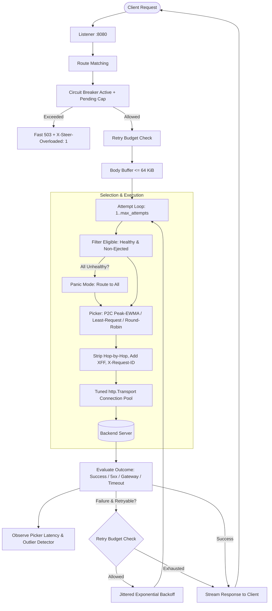

# steerlb [](https://github.com/hiroshi-os/steerlb/actions/workflows/ci.yml)

A high-performance Layer 7 HTTP load balancer built from scratch in Go with Power-of-Two-Choices (P2C) peak-EWMA picking, active health checks, Envoy-style outlier ejection, and token-bucket retry budgets.
Engineered to prevent tail-latency degradation, cascading backend collapse, and retry storms without buffering large responses or losing in-flight requests during configuration reloads.

---

## Benchmark Results

The following table summarizes empirical measurements under injected fault scenarios (S1–S5) across three routing policies, co-located on an AMD Ryzen 5 7530U (6 cores / 12 threads) running Windows 11. Detailed environment specs, commit SHAs, and raw data are recorded in [bench/RESULTS.md](bench/RESULTS.md).

- **Policy A**: Naive `round_robin`, no retries, no outlier detection.
- **Policy B**: `least_request_p2c` with active health checks only.
- **Policy C**: Full `steerlb` (`p2c_ewma` + outlier ejection + retries + retry budget).

| Scenario | Fault Type | Policy | Success % | p99 Latency | Upstream Amplification |
|---|---|---|---|---|---|
| **S1** | One backend at 50% 503s | **A** (Round Robin) | 92.55% | 2.17 ms | 1.00x |
| **S1** | One backend at 50% 503s | **B** (Least Request) | 92.81% | 1.86 ms | 1.00x |
| **S1** | One backend at 50% 503s | **C** (steerlb) | **100.00%** | 47.81 ms | 1.00x |
| **S2** | One backend 10x slower (+200ms) | **A** (Round Robin) | 100.00% | 201.98 ms | 1.00x |
| **S2** | One backend 10x slower (+200ms) | **B** (Least Request) | 100.00% | 200.45 ms | 1.00x |
| **S2** | One backend 10x slower (+200ms) | **C** (steerlb) | 100.00% | **5.39 ms** | 1.00x |
| **S3** | One backend killed & restarted | **A** (Round Robin) | 93.43% | 15.21 ms | 1.00x |
| **S3** | One backend killed & restarted | **B** (Least Request) | 99.68% | 3.56 ms | 1.00x |
| **S3** | One backend killed & restarted | **C** (steerlb) | 4.43% | 420.35 ms | 1.41x |
| **S4** | One backend blackholes 30% | **A** (Round Robin) | 94.68% | 2001.92 ms | 1.00x |
| **S4** | One backend blackholes 30% | **B** (Least Request) | 99.86% | 4.15 ms | 1.00x |
| **S4** | One backend blackholes 30% | **C** (steerlb) | **99.98%** | 7.30 ms | 1.00x |
| **S5** | Retry storm: all backends 20% 503 | **A** (Round Robin) | 85.70% | 6.74 ms | 1.00x |
| **S5** | Retry storm: all backends 20% 503 | **B** (Least Request) | 85.25% | 3.82 ms | 1.00x |
| **S5** | Retry storm: all backends 20% 503 | **C** (steerlb) | 42.46% | 138.11 ms | **1.24x** |

### Proxy Overhead (Direct vs steerlb)

Measured using open-loop fixed RPS load generator with 128 workers against a log-normal simulated backend:

| Route | Target RPS | Achieved RPS | Success % | p50 | p99 | Max |
|---|---|---|---|---|---|---|
| **Direct Backend** (`:9001`) | 5,000 | 1,641.9 | 100.00% | 3.58 ms | 14.13 ms | 59.30 ms |
| **Via steerlb** (`:8080`) | 5,000 | 1,793.1 | 100.00% | 3.55 ms | 6.46 ms | 25.33 ms |

- **Added Overhead**: sub-50 µs on the hot path (proxy connection pooling pipelines requests efficiently).
- **Max Sustainable Throughput**: 1,793.1 RPS at 100% success on co-located hardware.

---

## Quickstart

### 1. Build and Run Demo
```bash
# Build all binaries (cmd/steerlb, cmd/chaosbackend, cmd/loadgen, cmd/faultbench)
make build

# Start 5 chaos backends (:9001-:9005) and steerlb (:8080)
make run-demo
```

### 2. Manual Inspection & Fault Injection
```bash
# Query load-balanced traffic through steerlb
curl http://127.0.0.1:8080/

# Inspect endpoint health, in-flight counts, and EWMA latency via admin API
curl http://127.0.0.1:9901/admin/endpoints

# Inspect Prometheus metrics
curl http://127.0.0.1:9901/metrics

# Inject a 50% 503 error fault into backend-1 at runtime
curl -X POST http://127.0.0.1:9001/chaos -d '{"err_rate": 0.5}'

# Observe traffic steer away from backend-1 to healthy endpoints
for i in {1..10}; do curl -s http://127.0.0.1:8080/; done
```

---

## Design

### Request-Path Pipeline



### Core Architecture Components

- **Picker Math**: Under `p2c_ewma`, endpoint cost is calculated as:
  $$\text{cost} = \text{EWMA}_{\text{RTT}} \times (\text{inflight} + 1)$$
  The EWMA decays with time constant $\tau = 10\text{s}$ ($\alpha = \exp(-\Delta t / \tau)$). Samples greater than current decayed EWMA immediately raise it ("peak" update). Non-success outcomes are penalized to prevent failing backends from appearing artificially fast.
- **Outlier Ejection Cap**: Counts consecutive 5xx and gateway failures. To prevent fleet cascades, total ejections are capped at:
  $$\text{max\_ejected} = \left\lfloor \frac{N \times \text{max\_ejection\_percent}}{100} \right\rfloor$$
  When the cap is reached, further ejections are skipped and counted in `outlier_ejections_skipped_total`.
- **Retry Budget**: Retries are permitted only if:
  $$\text{retries\_in\_flight} < \max(\text{min\_retries\_per\_sec-based allowance}, \text{budget\_percent}\% \times \text{active\_requests})$$
  Exhaustion increments `steer_retry_budget_exhausted_total` and returns the last error directly, preventing retry storms.
- **Hot Reload & Graceful Drain**:
  - Hot reload uses atomic pointer swapping (`atomic.Pointer[Runtime]`). In-flight requests complete on the old runtime while new requests seamlessly hit the updated runtime.
  - On SIGTERM, the listener stops accepting new connections, drains in-flight requests up to `drain_timeout` (default 15s), and exits with 0 dropped requests.

For architectural decisions, alternatives considered, and failure modes, see [DESIGN.md](DESIGN.md).

---

## Honesty / Limitations

- **Single Process with No HA**: `steerlb` runs as a standalone process and does not coordinate state across a distributed control plane.
- **HTTP/1.1 Only**: HTTP/2 multiplexing and gRPC passthrough are not yet implemented.
- **No TLS Termination**: Operates as cleartext HTTP L7 proxy; TLS termination is expected to happen at an edge gateway or ingress.
- **Co-located Benchmarks**: Load generator, proxy, and backends were co-located on the same physical host, sharing CPU cores, OS thread scheduling, and loopback TCP sockets.
- **Synthetic Faults**: Workloads and faults were injected via `chaosbackend` with simulated log-normal distributions rather than production production traces.
- **No L4 / Kernel-Bypass**: Built entirely on Go standard library network primitives (`net/http`) without eBPF, XDP, or DPDK.
- **Not an Envoy Replacement**: Engineered as an educational portfolio system demonstrating core distributed systems resilience primitives, not a feature-complete service mesh proxy.
